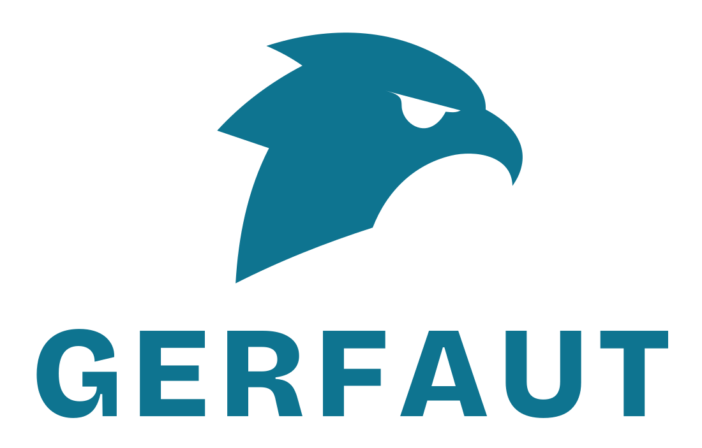
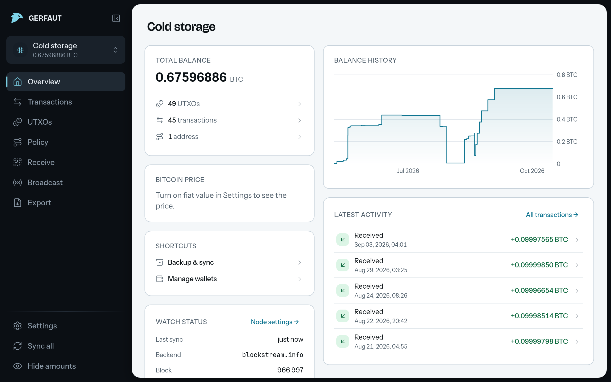
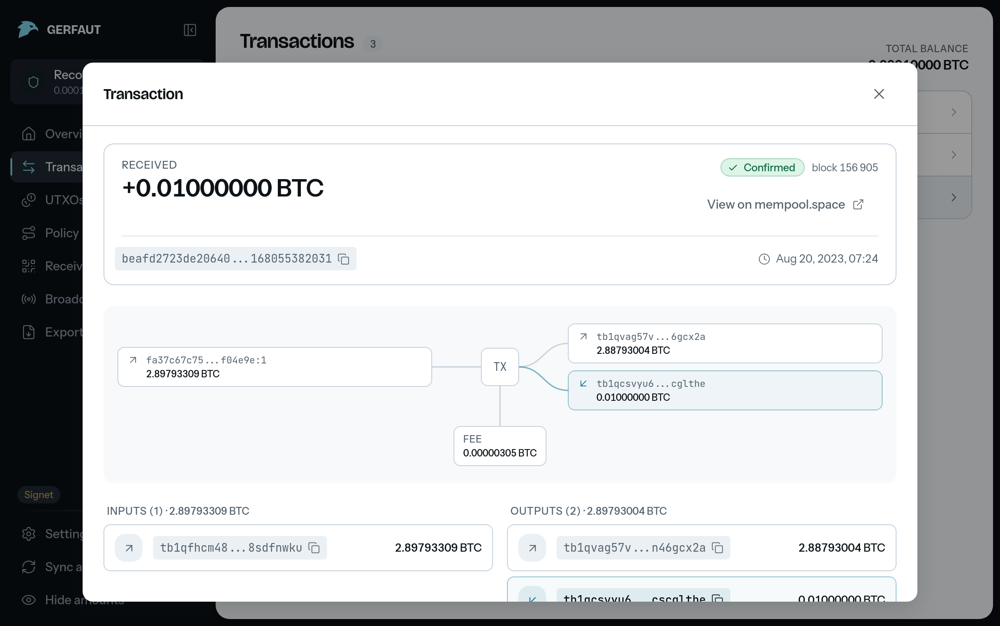
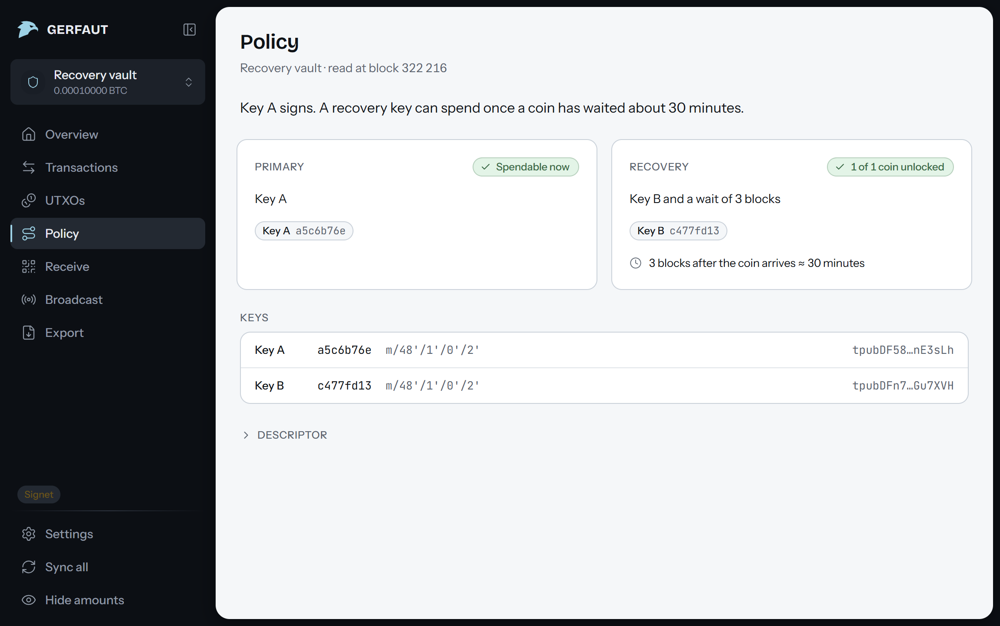
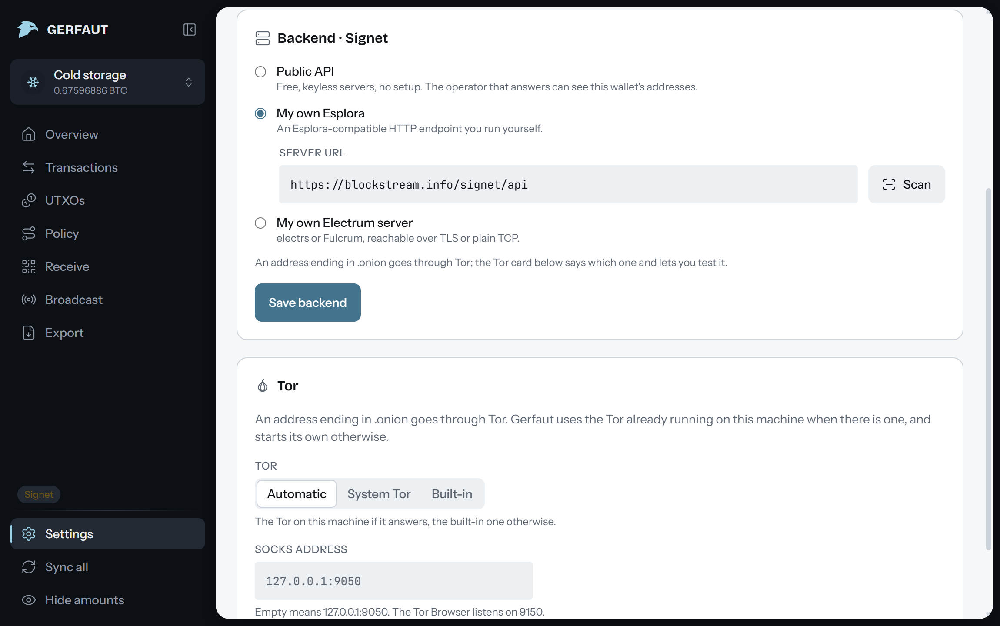
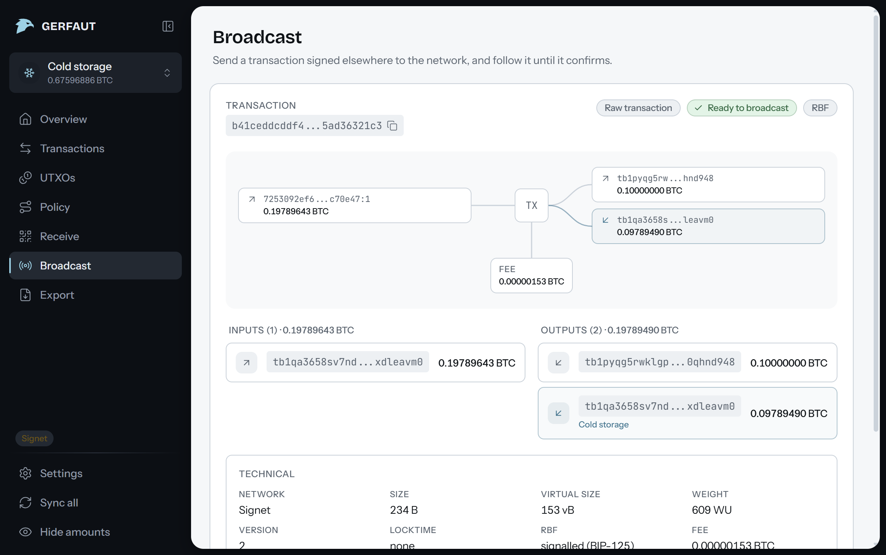

<div align="center">

<picture>
  <source media="(prefers-color-scheme: dark)" srcset=".github/images/logo-dark.svg">
  
</picture>

<h3>The Bitcoin watch-only wallet for Linux, macOS and Windows</h3>

Follow every wallet you own from its descriptor or public key.<br>
Gerfaut holds no private keys, so it can never spend your bitcoin.

[Download](https://gerfaut-wallet.com/download) · [Documentation](https://gerfaut-wallet.com/docs) · [Website](https://gerfaut-wallet.com) · [Android app](https://github.com/gerfaut-wallet/gerfaut-mobile)

[](https://github.com/gerfaut-wallet/gerfaut-desktop/actions/workflows/ci.yml)
[](LICENSE)

</div>

<br>



> [!NOTE]
> Gerfaut is in public beta. It cannot move your bitcoin, but it is new and has had little testing: check addresses and amounts on your signing device before you rely on them, and [open an issue](https://github.com/gerfaut-wallet/gerfaut-desktop/issues) when something looks wrong.

## Features

- Watch any wallet you already have: an output descriptor (Miniscript included), an xpub, ypub or zpub, a single address, a multisig setup, a BSMS record, or a Sparrow or Coldcard export. Paste it, open the file or scan the QR code, animated ones included.
- Open a transaction to see its inputs, outputs and fee on one diagram, and find every UTXO in a table of its own.
- Read a Miniscript policy in plain words: each spending path, with its timelock counted down to the block or the date it opens.
- Get a system notification when a transaction reaches the mempool, and another when it confirms, for as long as Gerfaut runs, minimised or locked.
- Connect to your own Electrum or Esplora server, or stay on a public one. An `.onion` backend goes through the Tor running on your machine, or through the Tor client built into Gerfaut when there is none.
- Broadcast a transaction signed elsewhere. Paste a PSBT or a raw transaction, open a file or scan a QR code, and Gerfaut shows what it does before it leaves.
- Lock Gerfaut with a PIN or a password. The vault is encrypted on disk, and an encrypted backup carries your wallets to the [Android app](https://github.com/gerfaut-wallet/gerfaut-mobile).

Gerfaut works on mainnet, signet, testnet4 and regtest, in a light or a dark theme. There is no code to generate keys, handle seeds or sign transactions, and no Send button.

<p align="center">
  
  
  
  
</p>

## Download

Get the file for your system from the [latest release](https://github.com/gerfaut-wallet/gerfaut-desktop/releases/latest):

| System | File |
|---|---|
| Linux, x86_64 | `Gerfaut_<version>_amd64.AppImage` for any distribution with glibc 2.35 or newer, `Gerfaut_<version>_amd64.deb` for Debian 12, Ubuntu 22.04 and newer, `Gerfaut-<version>-1.x86_64.rpm` for Fedora |
| macOS, Apple silicon and Intel | `Gerfaut_<version>_universal.zip` |
| Windows, 64-bit | `Gerfaut_<version>_x64-setup.exe` |

Apple has not notarized the app and the Windows installer has no code-signing certificate, so both systems warn you the first time. On macOS, open System Settings, then Privacy & Security, and select "Open Anyway". On Windows, select "More info", then "Run anyway". [Install on desktop](https://gerfaut-wallet.com/docs/getting-started/install-desktop) walks through each system.

### Verify your download

Every release ships a `SHA256SUMS` file signed with the author's [minisign](https://jedisct1.github.io/minisign/) key:

```
RWTz3c4gUmglCX5Uvjthigz1ts3TS3ZSdhRNpFgOJRW/Wr4XjGlqTR3O
```

Put `SHA256SUMS` and `SHA256SUMS.minisig` next to your file, then run:

```sh
minisign -Vm SHA256SUMS -P RWTz3c4gUmglCX5Uvjthigz1ts3TS3ZSdhRNpFgOJRW/Wr4XjGlqTR3O
sha256sum --check SHA256SUMS --ignore-missing   # macOS: shasum -a 256 --check SHA256SUMS --ignore-missing
```

The first command proves the list comes from the author, the second that your file matches it. For Windows, see [Verify a download](https://gerfaut-wallet.com/docs/getting-started/verify-your-download).

## Build from source

You need git, Node 24 and [rustup](https://rustup.rs). rustup installs the compiler named in `rust-toolchain.toml` the first time cargo runs. On Debian and Ubuntu, the webview and its build dependencies come from the distribution:

```sh
sudo apt-get install build-essential pkg-config curl wget file libwebkit2gtk-4.1-dev libayatana-appindicator3-dev librsvg2-dev patchelf libdbus-1-dev xdg-utils
```

On macOS and Windows, install the [Tauri prerequisites](https://v2.tauri.app/start/prerequisites/) instead.

The app builds [gerfaut-core](https://github.com/gerfaut-wallet/gerfaut-core) from the folder next to its own, at the revision `.github/gerfaut-core.rev` names:

```sh
git clone https://github.com/gerfaut-wallet/gerfaut-desktop
git clone https://github.com/gerfaut-wallet/gerfaut-core
git -C gerfaut-core checkout "$(cat gerfaut-desktop/.github/gerfaut-core.rev)"
cd gerfaut-desktop
npm ci
npm run tauri dev     # run the app
npm run tauri build   # build the installers into src-tauri/target/release/bundle
```

Release files come out of the pinned Linux container in `reproducible/`, the Windows installer and the macOS app included. To build them the way the release workflow does, run `reproducible/build.sh linux`, `windows` or `macos`. It needs git and Docker or Podman, and `reproducible/build.sh --help` lists what each target asks for.

## Contributing

Bug reports and pull requests are welcome. Open an issue before any change beyond a small fix, and read [CONTRIBUTING.md](CONTRIBUTING.md) first: it explains the license of contributions and the one hard rule, which is that Gerfaut stays watch-only. Before you push, run what CI runs:

```sh
npx tsc -b && npx vitest run
cd src-tauri && cargo fmt --check && cargo clippy --all-targets -- -D warnings && cargo test
```

## Security

Do not report a vulnerability in a public issue. Use [private vulnerability reporting](https://github.com/gerfaut-wallet/gerfaut-desktop/security/advisories/new) or write to info@pandul.fr. [SECURITY.md](SECURITY.md) lists what is in scope and what to expect.

## License

Gerfaut is free software under the [GNU Affero General Public License v3.0 only](LICENSE). For a commercial license, write to info@pandul.fr.

The Gerfaut name and logo are not covered by the code license. See [TRADEMARK.md](TRADEMARK.md).
